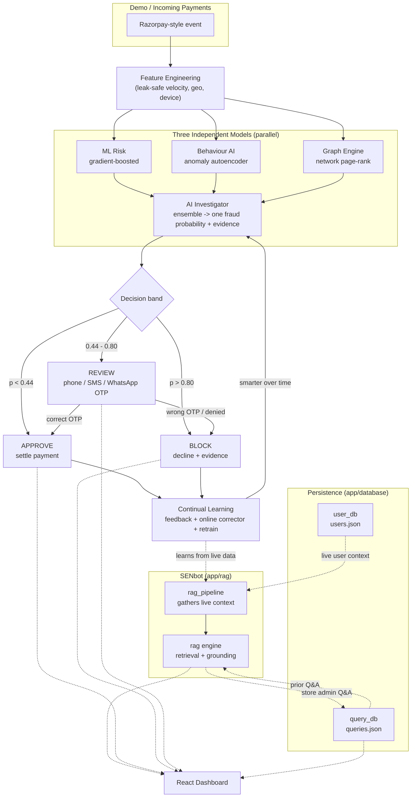

# Sentinel AI — Razorpay Fraud Guardian

An **end-to-end AI fraud-detection system** built for the Razorpay buildathon
**(Track 02 — AI Risk Manager)**, and strictly **defense-only**.

Sentinel AI watches **every payment**, explains its verdict with evidence,
**phone-confirms borderline cases** via call / SMS / WhatsApp OTP before
settling, and **learns from every outcome** over time. It ships with an honest,
held-out evaluation (no leakage), so the metrics you see are the metrics it
really would produce.

> **Live demo:** *(paste your deployed dashboard URL here — e.g. https://your-demo.onrender.com)*
> The dashboard visualises the entire pipeline: live payment checks, model
> explanations, the phone-verification panel (call / SMS / WhatsApp), and the
> SENbot admin assistant.

---

## How it works — Data Flow (DFD)



**The one-paragraph story:** every payment becomes a leak-safe feature vector,
scored in parallel by three very different models. An **AI Investigator**
combines them into one calibrated fraud probability, then picks a decision band:
low risk is **approved**, medium risk is **held for a phone call** (the customer
must confirm an OTP via call, SMS, or WhatsApp before the money moves), and high
risk is **blocked**. Every outcome feeds back so the system gets smarter and the
admin can ask questions in natural language through **SENbot**.

---

## What makes it different

- **Explainable, not a black box.** Every verdict ships with an evidence list
  (which model fired and why — velocity, geography, bot cadence, shared device,
  ensemble agreement).
- **A human safety net.** Borderline payments are *not* auto-approved. The
  customer confirms ownership via **phone call, SMS, or WhatsApp OTP** before
  settlement.
- **Learns continually.** Confirmed outcomes adapt the model immediately
  (online corrector) and on retrain — defense-only, it may only escalate a
  decision, never silently weaken it.
- **SENbot reads the live data.** A built-in RAG assistant answers
  *"what's the issue and what should I do?"* grounded in the real, current
  dataset — no embedding server or API key needed.

---

## The three models

| Model | Approach |
|-------|----------|
| **ML Risk** | Supervised gradient-boosted classifier + calibration |
| **Behaviour AI** | Unsupervised autoencoder on legit-only behaviour, reconstruction-anomaly scoring |
| **Graph Engine** | Heterogeneous payer / card / device graph + influence propagation from confirmed-fraud seeds |

Each fraud vector in the demo is engineered around a **known real-world scam**:

| Vector | Pattern |
|--------|---------|
| `CARD_TESTING` | many tiny transactions to validate stolen card numbers |
| `VELOCITY_BURST` | burst of high-value charges from one payer |
| `BOT_AUTOMATION` | machine cadence, fast typing, same device/card |
| `COLLUSION_RING` | a set of payers sharing devices/cards and cross-funding |
| `STOLEN_CARD` | new device + high value + billing/shipping mismatch |
| `UPI_P2P` | suspicious UPI peer-to-peer transfer to new beneficiary |
| `ACCOUNT_TAKEOVER` | sudden device + password change + high-value payout |
| `REFUND_ABUSE` | rapid refund requests in a short session window |
| `MERCHANT_BIN` | abnormal merchant concentration on a single BIN |

---

## Honest results (held-out test set, seed 42)

Measured on a **held-out split** the ensemble never trained on — no leakage.

| Metric | Value |
|--------|-------|
| **Precision** | **1.000** |
| **Recall (fraud blocked)** | **0.978** (180 / 184) |
| **F1** | **0.989** |
| False positives (legit blocked) | **0** |
| False negatives (fraud approved) | 4 |
| Investigator AUC | 0.998 |

**Cost outcome:** false-positive cost **Rs.0**, false-negative cost **Rs.22,176**,
**total Rs.22,176** vs. a no-intervention baseline of **Rs.10,20,088** =
**Rs.9,97,913 of money prevented**. The 4 "false negatives" were approved
payments; each stays visible in the dashboard for review and can be labelled via
feedback to improve the next model.

---

## Demo roles

| Role | Credentials |
|------|-------------|
| Admin | `admin` / `admin123` |

The admin has full access: live scoring, investigation reports, phone / SMS /
WhatsApp OTP verification, SENbot Q&A (with search + delete), and continual
learning retrain.

---

## Run it yourself

Requires **Python 3.10+** and **Node 18+**.

### Option A — local (recommended for development)

```bash
# Backend
cd backend
pip install -r requirements.txt
python train.py                       # one-time: train + save model artifacts
uvicorn app.main:app --port 8100      # API + serves built dashboard if present

# Dashboard (second terminal)
cd frontend/app
npm install
npm run dev
```

Open **http://localhost:5173** for the dashboard (Vite proxies `/api` to `:8100`).

On Windows you can also run `powershell -ExecutionPolicy Bypass -File start.ps1`
to launch both at once.

### Option B — Docker (hardened stack: app + PostgreSQL + Redis)

Build and run in one step — no local Node or Python setup needed beyond Docker.
`docker compose` brings up **three** services: the **app** (API + built
dashboard), **PostgreSQL** (durable store for users, queries, feedback,
verifications, transactions and the human review queue) and **Redis** (OTP /
verification session store). The app image is **hardened**: it runs as a
non-root user on a read-only root filesystem, drops all capabilities, and
stores **no data or secrets** in the image (see [SECURITY.md](SECURITY.md)).

```bash
# Provide runtime secrets from the environment / secret manager
export SENTINEL_AUTH_SECRET="$(openssl rand -hex 32)"
export SENTINEL_ADMIN_PASSWORD='a-strong-admin-password'
export POSTGRES_PASSWORD='a-strong-db-password'
docker compose up --build -d      # recommended (Postgres + Redis + volumes)
docker compose down               # stop (data is kept in volumes)
```

> The compose file requires `SENTINEL_AUTH_SECRET`, `SENTINEL_ADMIN_PASSWORD` and
> `POSTGRES_PASSWORD` (they are never hardcoded). Set them as above or via your
> secret manager. Without them `docker compose up` refuses to start.

Open **http://localhost:8100** — the built React dashboard and the FastAPI API
are both served from the same container.

> The first build takes a few minutes (it installs deps, builds the frontend
> with Vite, and trains the model). Subsequent builds are fast thanks to layer
> caching.

**Persistence & cache wiring.** `docker-compose.yml` points the app at the two
backing services via env vars — no code change needed:

- `DATABASE_URL=postgresql+psycopg2://…@db:5432/sentinel` → PostgreSQL.
- `REDIS_URL=redis://redis:6379/0` → Redis (shared, TTL-bounded OTP sessions).

**Runtime data lives on persistent volumes, not in the image.** New/uploaded
datasets, investigated users, customer-care queries, feedback labels, OTP
verification log, transactions and the review queue live in PostgreSQL (volume
`pgdata`); OTP sessions live in Redis (volume `redis_data`). `docker-compose.yml`
mounts `sentinel_data`, `sentinel_db` (SQLite fallback), `pgdata` and
`redis_data` so state survives restarts and rebuilds.

Without Docker you can still run the app locally against **SQLite + in-memory**
(no servers needed) — that is the default when `DATABASE_URL` / `REDIS_URL` are
unset. To use your own PostgreSQL/Redis, just set those two env vars.

Nothing is baked into the Dockerfile except static model artifacts (the approved
model version, trained at build time) and code — all runtime writes go to
volumes/databases, and all secrets are injected at runtime.

For the full hardening runbook (secrets, auth, CORS, OTP, container
privileges, supply chain), see **[SECURITY.md](SECURITY.md)**.

---

## Tech stack

- **Backend:** FastAPI, Python, XGBoost, scikit-learn
- **Persistence:** SQLAlchemy — PostgreSQL (production) / SQLite (default), Redis
  for OTP sessions (in-memory fallback)
- **Frontend:** React + Vite + Recharts
- **Extras:** offline TF-IDF RAG (SENbot), simulated Twilio phone / SMS / WhatsApp
  verification (real Twilio supported via env keys)

---

## Project layout

```
razorpay-fraud-detector/
├── backend/
│   ├── app/
│   │   ├── data_generator.py      # Razorpay-style events (9 fraud vectors)
│   │   ├── features.py            # leak-safe feature engineering (per-key windows)
│   │   ├── models/
│   │   │   ├── ml_risk.py         # supervised risk scorer (XGBoost)
│   │   │   ├── behaviour_ai.py    # anomaly autoencoder
│   │   │   └── graph_engine.py    # network graph model
│   │   ├── investigator.py        # ensemble + evidence
│   │   ├── verification.py        # phone / SMS / WhatsApp OTP verification
│   │   ├── feedback.py            # continual learning
│   │   ├── cache.py               # OTP session store (Redis + memory fallback)
│   │   ├── database/              # persistence layer (SQLite / PostgreSQL)
│   │   │   ├── db.py              #   engine/session/init_db (DATABASE_URL)
│   │   │   ├── models.py          #   ORM: users, queries, feedback, verifications,
│   │   │   │                      #        transactions, review_queue
│   │   │   ├── user_db.py         #   user / payer database
│   │   │   ├── query_db.py        #   customer-care query database
│   │   │   ├── events.py          #   persisted scored transactions
│   │   │   ├── verifications.py   #   verification / OTP audit log
│   │   │   └── review.py          #   human review queue
│   │   ├── api_docs.py            # curated OpenAPI / Swagger metadata
│   │   ├── rag/                   # SENbot — admin Q&A (offline RAG)
│   │   │   ├── rag_knowledge.py   #   static "issues & remedies" runbook
│   │   │   ├── rag.py             #   TF-IDF retrieval + grounded answering
│   │   │   └── rag_pipeline.py    #   orchestration, feeds live DB context
│   │   └── main.py                # FastAPI + serves built dashboard (SPA)
│   ├── tests/                     # pytest suite (unit + API integration)
│   ├── conftest.py, pytest.ini    # test fixtures / config
│   ├── load_test.py               # latency/throughput harness -> docs/PERFORMANCE.md
│   ├── export_openapi.py          # writes docs/openapi.json + docs/API.md
│   ├── train.py                   # train + save artifacts
│   └── requirements.txt
├── docs/                          # openapi.json, API.md, PERFORMANCE.md
├── frontend/
│   └── app/                       # React (Vite) dashboard
│       └── src/
│           ├── App.jsx            # main dashboard shell + nav
│           ├── api.js             # API client (auth + fetch helpers)
│           └── components/
│               ├── Login.jsx          # admin login
│               ├── AdminRagPanel.jsx   # SENbot Q&A panel
│               ├── UserDatabasePanel.jsx  # investigated users + deletion
│               └── ...               # other dashboard panels
├── Dockerfile                     # multi-stage build (frontend + API)
├── docker-compose.yml             # app + PostgreSQL + Redis (hardened)
├── .dockerignore                  # keeps Docker image clean
├── .gitignore
├── start.ps1                      # launch both (Windows)
└── README.md
```

---

## API endpoints

Auth (`/api/auth`: login, me, roles), health (`/api/health`), status
(`/api/system`), scoring (`/api/summary`, `/api/events`, `/api/investigate`,
`/api/vectors`, `/api/test-metrics`), demo shortcuts (`/api/demo/clean|fraud`),
phone/OTP verification (`/api/verify/event`, `/api/verification…`), the human
review queue (`/api/review…`), continual learning (`/api/feedback…`,
`/api/learning/retrain`), users (`/api/users…`), customer-care queries
(`/api/queries…`), SENbot RAG (`/api/rag…`) and Razorpay ingest (`/api/rzp…`).

| Method | Path | What it does |
|--------|------|--------------|
| POST | `/api/auth/login` | Authenticate; returns a token |
| GET | `/api/auth/me`, `/api/auth/roles` | Current identity / available roles |
| GET | `/api/health` | Liveness probe (used by Docker HEALTHCHECK) |
| GET | `/api/system` | Storage backend, cache backend, verification mode, counts |
| GET | `/api/summary` | Model summary + decision metrics |
| GET | `/api/events?risk=&limit=` | Recent payments with scores & decisions |
| GET | `/api/events/{event_id}` | Full investigation report for one event |
| POST | `/api/investigate` | Score a live payment (approve / review / block + evidence) |
| GET | `/api/vectors` | Fraud-vector distribution |
| GET | `/api/test-metrics` | Honest held-out precision / recall / F1 + cost |
| GET | `/api/demo/clean`, `/api/demo/fraud` | One-click demo payments |
| POST | `/api/verify/event` | Start phone / SMS / WhatsApp OTP verification |
| GET | `/api/verification`, `/api/verification/{id}` | List / fetch OTP verification sessions |
| POST | `/api/verification/{id}/confirm` | Confirm the correct OTP → approve |
| POST | `/api/verification/{id}/deny` | Reject → record a failed attempt |
| POST | `/api/verification/{id}/resend` | Resend the OTP |
| GET | `/api/review?status=`, `/api/review/stats` | Human review queue + stats (admin) |
| POST | `/api/review/{review_id}/resolve` | Approve / block a queued item (feeds learning) |
| GET | `/api/feedback` | Recorded feedback / labels |
| POST | `/api/feedback/{event_id}/correct` | Mark clean / fraud (continual learning) |
| POST | `/api/learning/retrain` | Retrain on confirmed feedback |
| GET | `/api/users`, `/api/users/stats`, `/api/users/search?q=` | Investigated users |
| GET, DELETE | `/api/users/{user_id}` | Fetch / delete a user + their events (admin) |
| GET, POST | `/api/queries` | List / raise customer-care queries |
| GET | `/api/queries/stats`, PATCH `/api/queries/{id}` | Query stats / update |
| POST | `/api/rag/ask` | SENbot Q&A (runbook + live dataset) |
| GET | `/api/rag/status`, `/api/rag/knowledge` | SENbot status / runbook |
| POST | `/api/rzp/create-order`, `/api/rzp/webhook` | Razorpay order / ingest |
| GET | `/api/rzp/status`, `/api/rzp/demo-payment` | Razorpay status / demo |

> Interactive, always-current reference: **`/docs`** (Swagger) and **`/redoc`** at
> runtime, or the generated [docs/API.md](docs/API.md) / [docs/openapi.json](docs/openapi.json).

---

## Testing & performance

```bash
cd backend
python -m pytest                       # unit + API integration tests
python load_test.py --n 300 --concurrency 8   # latency/throughput -> docs/PERFORMANCE.md
python export_openapi.py               # regenerate docs/openapi.json + docs/API.md
```

The suite uses a throwaway SQLite DB and an in-memory cache, so it needs no
servers. Live scoring is single-pass per request (scoped feature build) —
see [docs/PERFORMANCE.md](docs/PERFORMANCE.md) for p50/p95 numbers.

---

## Optional real integrations

Copy `backend/.env.example` → `backend/.env` and fill in keys. `.env` is
gitignored — never commit it.

- **Razorpay keys** (`rzp_test_*`) — enable `/api/rzp/create-order` and real
  `/api/rzp/webhook` ingestion.
- **Twilio keys** (account SID, auth token, phone number) — enable real outbound
  phone / SMS / WhatsApp payment confirmation. Without keys the flow runs in
  fully simulated mode and all OTP details are logged in the dashboard.

---

Built for **Razorpay AI Buildathon — Track 02 / AI Risk Manager**. Defense-only,
explainable, and honest about its numbers.
